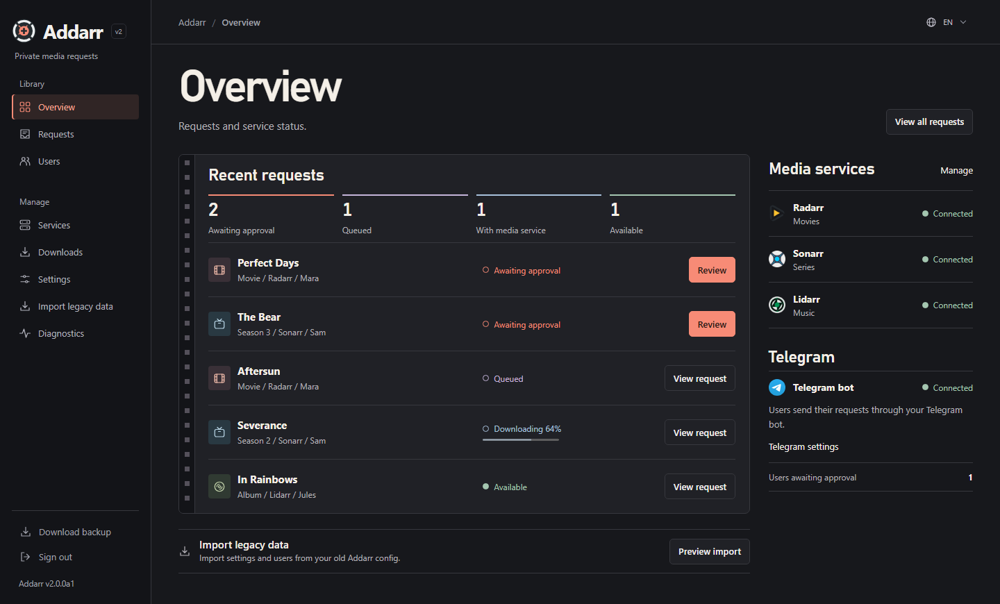

# Addarr

Request movies, TV shows and music in Telegram. Addarr sends approved requests to Radarr, Sonarr or Lidarr. Use the web interface to review requests and manage access.

Version 2 is an [alpha rebuild of Addarr Refresh](docs/IMPLEMENTATION-STATUS.md).



## Docker setup

Save [`docker-compose.yml`](https://raw.githubusercontent.com/Cyneric/Addarr/main/docker-compose.yml) in its own directory and create a `config` folder next to it. On Linux, make the folder writable by the container with `sudo chown 1000:1000 config`, or set `PUID` and `PGID` in `.env` to match its owner.

Run these commands from the directory with the Compose file:

```sh
docker compose pull
docker compose up -d
```

Open <http://127.0.0.1:8090> on the Docker host. For access from another device, set `ADDARR_BIND` in `.env` to the host's LAN address. Use the web interface over a LAN or VPN.

| Variable | Default | Purpose |
| --- | --- | --- |
| `ADDARR_BIND` | `127.0.0.1` | Host address for the web interface |
| `ADDARR_PORT` | `8090` | Host port for the web interface |
| `ADDARR_CONFIG` | `./config` | Host directory mounted at `/config` |
| `PUID` / `PGID` | `1000` / `1000` | Container user and group |
| `ADDARR_VERSION` | `main` | Tag for `ghcr.io/cyneric/addarr`. Use `sha-<commit>` to pin a published build. |

Keep the config directory on the Docker host's local storage. Addarr stores its SQLite database there. Avoid SMB and NFS shares.

### First run

1. Copy the token from `config/bootstrap-token` into the setup page and create an admin account. Addarr deletes the token after setup.
2. In **Services**, enter a service URL and API key. Click **Test connection**, choose your defaults and save. Lidarr also needs a metadata profile. Use a LAN address or a service name on a shared Docker network. `localhost` inside the container points to Addarr itself.
3. In **Settings**, enter your Telegram bot token, choose a language and enable the bot. Set up a media service first. Stop any older Addarr instance using the same token.
4. Send `/start` to the bot in a private chat. In **Users**, check your Telegram user ID and approve access. You can also create a single-use invite once the bot is connected.

## Using Addarr

Send `/start` to open the Telegram menu or use `/movie`, `/series` or `/music` to search. Requests need approval by default. Use `/requests` to check their status.

- [Telegram commands, approvals and group chats](docs/TELEGRAM.md)
- [Download progress with SABnzbd](docs/TELEGRAM.md#download-progress)
- [Import an older Addarr installation](docs/MIGRATION.md)
- [Update Addarr with Docker Compose or the web updater](docs/UPDATES.md)

## Backups and password recovery

Use **Download backup** in the web sidebar or run:

```sh
uv run addarr --data-dir ./config backup /safe/location/addarr.db
```

Store backups somewhere private. They contain service credentials and admin account data.

To reset a web account's password:

```sh
uv run addarr --data-dir ./config reset-password USERNAME
```

The command asks for a new password without displaying it and signs out all web sessions.

## Development

Requires Python 3.13 and uv.

```sh
uv sync --frozen --group dev
uv run addarr --data-dir ./config serve --host 127.0.0.1
```

`python run.py` also starts Addarr after you install the dependencies. Put `--data-dir` before the subcommand. `--help` and `--version` work without a config file.

To build and run the Docker image from this checkout:

```sh
docker compose -f docker-compose.yml -f compose.build.yml up -d --build
```

To run the checks:

```sh
uv run pytest -q
uv run mypy addarr
uv run ruff check addarr tests
```

See the [architecture notes](docs/ARCHITECTURE.md) for request states and error handling, and the [release checklist](docs/RELEASE-CHECKLIST.md) for browser, container, migration and live-service tests.

## License

Addarr uses the [MIT license](LICENSE). See the bundled [HTMX license](addarr/static/htmx.LICENSE) and [logo sources](addarr/static/logos/SOURCES.md).
